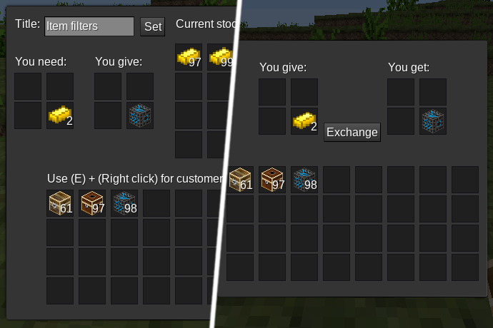

# Exchange Shop

## Description

This mod adds an improved ("currency" compatible) shop to your world.

Requires Luanti 5.0.0 or newer

**Features:**

 * 4 buyer and 4 seller slots
 * Much storage capacity
 * Custom shop title
 * `pipeworks` support
 * `tubelib` support
 * [`hopper`](https://github.com/minetest-mods/hopper) support
 * Replaces the `currency` shops

## License

Textures: CC0 - or see notes below

Code: MIT

Following textures were imported from [currency](https://github.com/minetest-mods/currency)
 * shop_front.png
 * shop_side.png
 * shop_top.png
